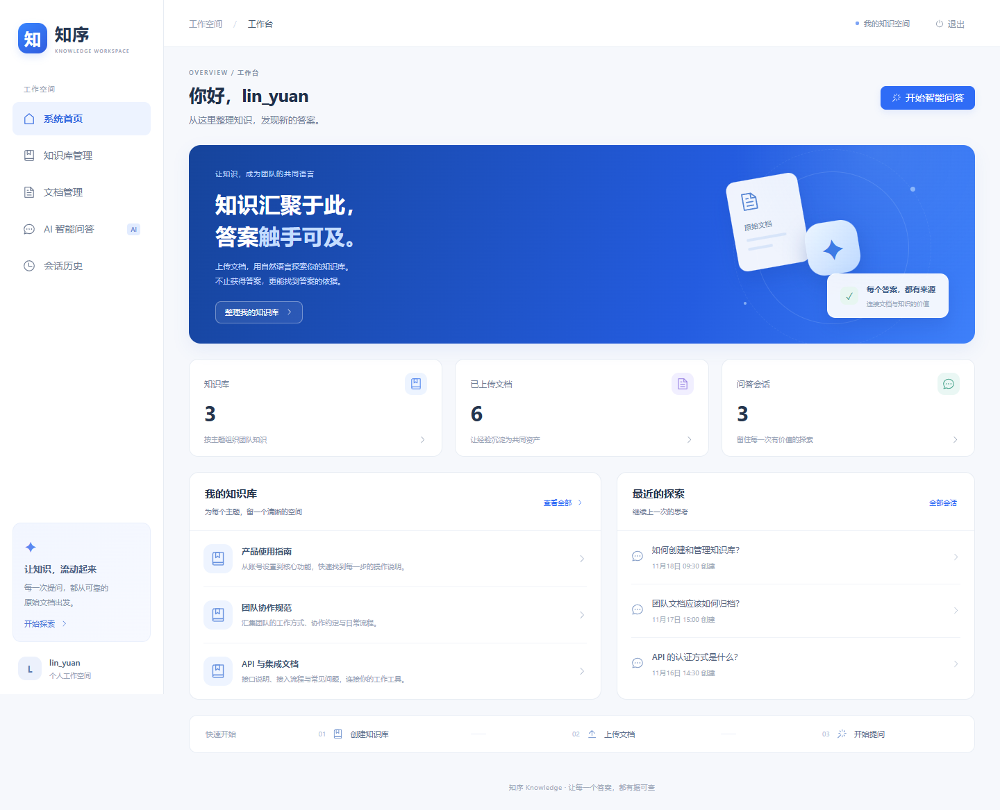
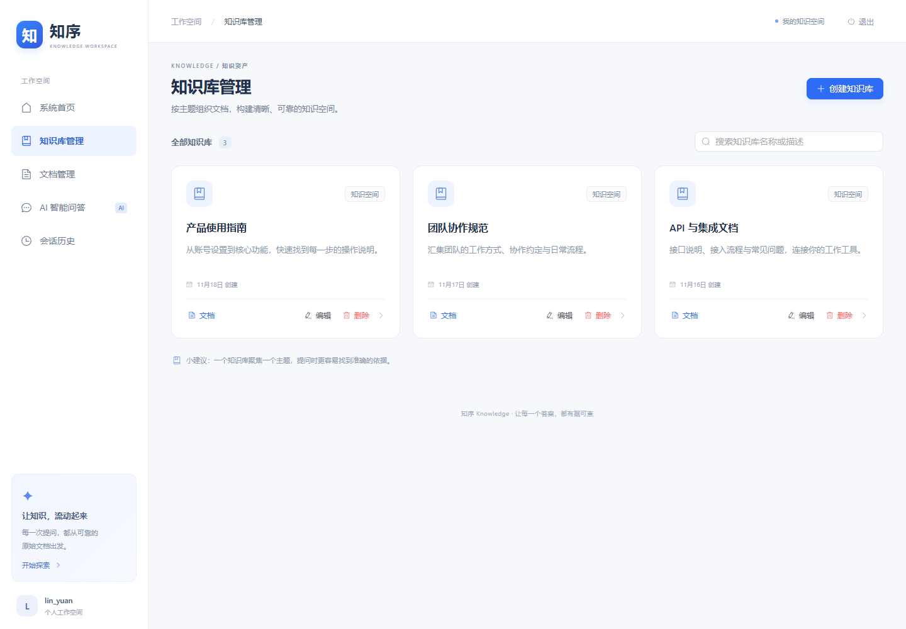
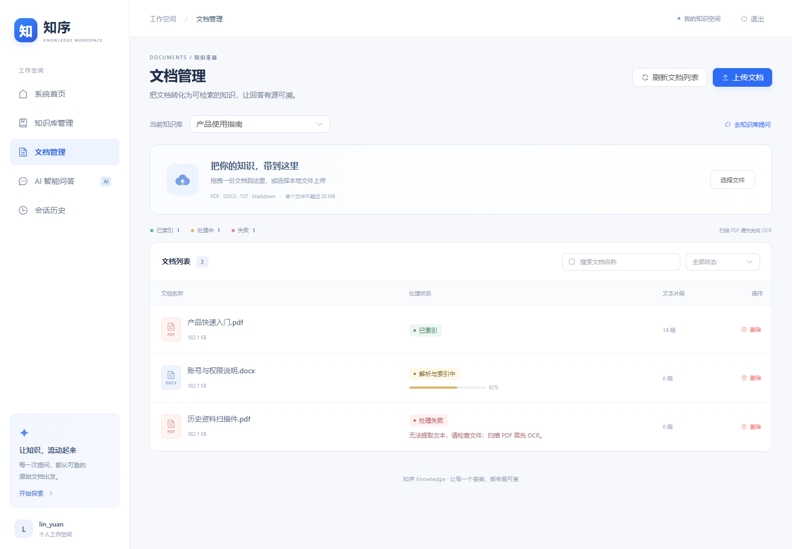
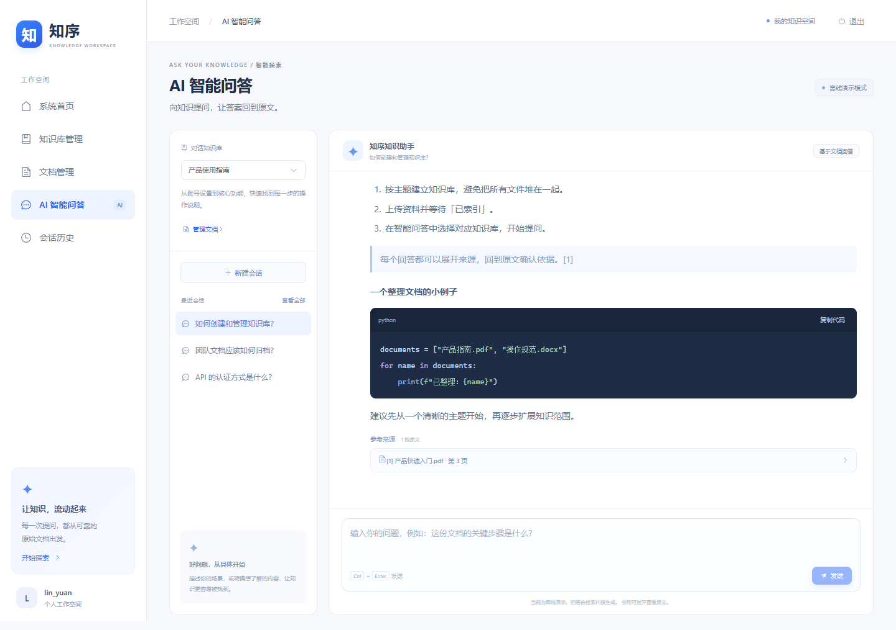
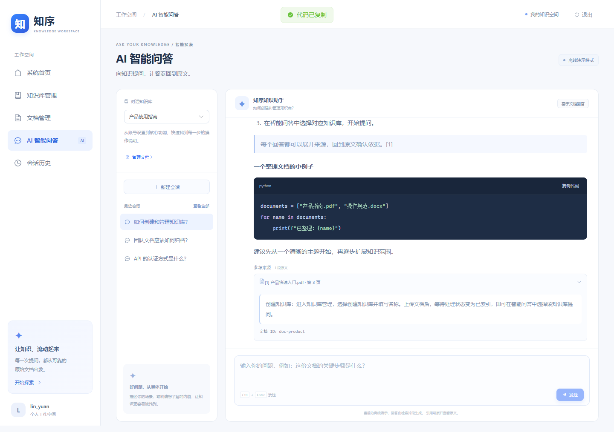
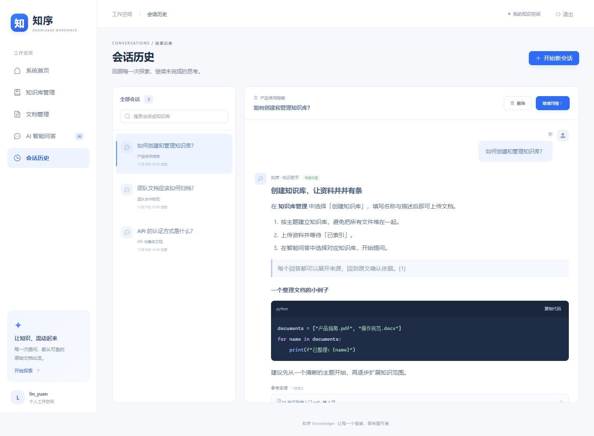
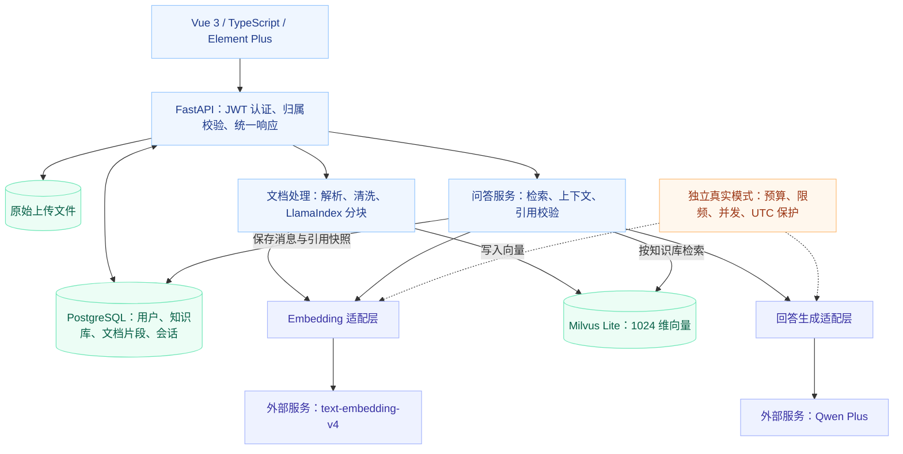
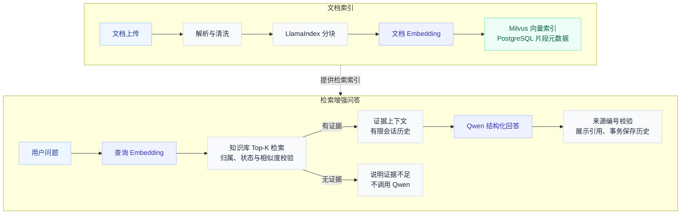

# 知序 · RAG-Knowledge

一个将个人文档整理为可检索、可追溯知识库的全栈 AI 应用。上传资料后，用自然语言提问，并通过原文片段核对答案依据。

面向个人资料管理、产品手册和制度文档查询等场景，串联文档处理、向量检索、模型生成与会话持久化。V1.0 已完成限定范围的真实 RAG 端到端验收；默认启动仍为 **Mock 模式，无需模型 API Key**。

[功能展示](#功能展示) · [系统架构](#系统架构图) · [快速开始](#快速开始) · [开发阶段](#开发阶段) · [已知限制](#已知限制与安全说明)

## 技术栈

| 层次 | 技术 | 在项目中的作用 |
|---|---|---|
| 前端 | Vue 3 · TypeScript · Vite · Element Plus | 六页工作台、文档管理、问答与历史展示 |
| 后端 | Python · FastAPI · Pydantic Settings | REST API、配置管理、请求校验与统一错误响应 |
| 关系数据 | PostgreSQL · SQLAlchemy · Alembic | 用户、知识库、文档片段、会话与增量迁移 |
| 文档处理 | PyMuPDF · python-docx · UTF-8 文本解析 | PDF、DOCX、TXT、Markdown 解析与位置保留 |
| RAG | LlamaIndex SentenceSplitter · Milvus Lite | 文本分块、1024 维向量索引与 COSINE 检索 |
| 模型 | Qwen Plus · text-embedding-v4 | 真实回答生成、文档及查询向量化 |
| 内容展示 | MarkdownIt · DOMPurify · highlight.js | Markdown、代码高亮与受限内容渲染 |
| 验证与部署 | pytest · Playwright · Docker Compose · Nginx | 离线/Mock 验证、浏览器验收与本地部署 |

LlamaIndex 在本项目中主要承担文本切分；检索编排、来源校验、模型适配和费用保护由应用代码实现。SQLite 仅作为本地开发便利选项，不能代替 PostgreSQL 验收。

## 功能展示

以下为**合成 UI 示意图（实际 Vue 界面 + Mock API 数据）**，仅用于展示已实现的页面与交互，不是生产环境或真实模型调用的运行截图。画面中的账号别名、文件名、统计及对话均来自测试夹具，不包含个人业务数据。点击图片可查看大图。

| 系统首页 | 知识库管理 |
|---|---|
|  |  |
| 汇总知识库、文档和会话，提供快捷入口；生产页面读取实际接口，未知统计显示“—”。 | 按主题组织资料，支持搜索、创建、编辑、删除及空状态反馈。 |

| 文档管理 | AI 智能问答 |
|---|---|
|  |  |
| 展示上传入口、处理进度、片段数量和失败原因，区分已索引、处理中与失败。 | 左侧切换知识库与会话，右侧展示 Markdown、代码块、消息及来源入口。 |

| 来源引用 | 会话历史 |
|---|---|
|  |  |
| 展开已有引用，核对文档名称、原文片段与 PDF 页码；不因此追加模型调用。 | 搜索、预览及继续已有会话，保留服务端返回的消息与引用快照。 |

截图来源、字节指纹和隐私复核范围见[公开截图说明](docs/images/product/README.md)。界面设计及交互实现见[Stage 6](docs/stage6.md)。

## 系统架构图



图中“服务”和“适配层”是后端代码模块，不是额外的微服务。Milvus Lite 由后端使用本地持久化存储；PostgreSQL 保存元数据与文本，原文件单独保存，Qwen 与 Embedding 为外部模型服务。

普通 Mock 入口替换模型实现；独立真实环境在统一模型执行边界增加持久化门禁。详细设计见[系统架构](docs/ARCHITECTURE.md)与[真实运行架构](docs/REAL_USAGE_ARCHITECTURE.md)。

## RAG 工作流程



上传和提问都会产生各自的向量化请求。长文档按片段和输入规模分批，不能把“一次上传”等同于“一次 Embedding”。没有已索引文档时可直接提示证据不足；没有可用检索证据时不调用 Qwen 生成。

实现入口：[文档服务](backend/app/services/documents.py) · [问答服务](backend/app/services/chat.py) · [模型适配器](backend/app/rag/providers.py) · [向量适配器](backend/app/rag/vectors.py)。

## 核心技术亮点

- **身份与知识库隔离**：JWT 认证后核验知识库、文档及会话归属；检索先限定知识库，再通过关系库复核片段、文档归属和索引状态。对应[权限依赖](backend/app/api/deps.py)。
- **可追踪的文档处理**：支持上传、解析、分块、索引及失败状态；PDF 按页解析以保留真实页码，DOCX/TXT 等不推测页码。删除通过持久化中间状态协调向量、文件和元数据，失败保留恢复线索。
- **来源由服务端关联**：模型只返回回答及来源编号；应用校验编号与回答中的引用，文档 ID、名称、片段和位置取自检索结果。文档及历史被标记为不可信输入，不提供执行其中指令的工具入口。
- **消息与引用一并保存**：成功生成并通过引用校验后，在同一数据库事务中保存用户问题、回答和引用快照；前端可恢复历史，不自动重发未确认请求。
- **Mock 与真实模型明确分离**：同一适配接口支持离线演示和 Qwen 兼容 API；真实模型异常不会静默回退 Mock。独立 `infrastructure` 模式阻止模型调用。
- **持久化费用保护**：独立真实环境提供日/月估算预算、请求次数与频率限制、单并发和重复操作保护。请求先保守预留，失败、超时或结果不确定时保留记录并暂停；HTTP 自动重试关闭。对应[费用门禁](backend/app/real_usage/guard.py)与[受保护模型](backend/app/real_usage/models.py)。
- **可信时间与受控恢复**：结合墙钟、单调时钟及持久化时间下界检测回拨、漂移和跨 UTC 日重启；异常保持暂停，人工确认通过可审计的 epoch 推进建立新观察周期，保留旧记录。不能补证的历史连续性仍保留未验证结论。

这些保护面向个人、单实例使用，不等同于完整生产级安全体系；普通演示入口并不具备独立真实环境的全部费用门禁。

## 测试与验收

以下为**已执行的历史证据**，本次 README 优化没有重新运行业务测试或调用模型。

| 验证类别 | 既有结论 | 范围与证据 |
|---|---|---|
| 离线 API / Mock | PASS | 接口、隔离、异常与前端交互；见[系统测试报告](docs/final-delivery/SYSTEM_TEST_REPORT.md)及各 Stage |
| UI / 浏览器 Mock | PASS | M6 的 27 个不同 Mock 场景，另有 M6.5 定向复核；见[Stage 6](docs/stage6.md) |
| PostgreSQL / Milvus / 持久化 | PASS | 专用基础设施、虚构测试向量、文件与独立备份恢复；见[Stage 7](docs/stage7.md) |
| 真实后端 / 浏览器 RAG | PASS | 真实后端、M5、断点续验及 R4.6 按各自范围验收；见[Stage 8](docs/stage8.md) |

### R4.6：恢复后的一次真实端到端验收

使用无敏感信息的故障响应制度 TXT，上传一次、提问一次；**真实 Embedding 共 2 次 VERIFIED，Qwen 共 1 次 VERIFIED**。

| 环节 | 实际模型请求 | 结果 |
|---|---|---|
| 文档上传、解析、索引 | 文档 Embedding × 1 | VERIFIED，文档成功索引 |
| 问题向量化与检索 | 查询 Embedding × 1 | VERIFIED，检索到测试文档 |
| 回答生成 | Qwen × 1 | VERIFIED，回答包含“15分钟”和“4小时” |
| 来源与历史 | 无额外模型调用 | 引用指向测试文档原文，会话保存与读取通过 |

验收答案：“P1级故障的响应时间为15分钟，恢复目标为4小时[1]”。记录还核对了费用账本和时钟门禁。可公开的结论与追溯关系见[实际开发历程](docs/development-history.md)及[验收阶段](docs/stage8.md)；包含运行信息的原始审计不随源码分发。

这是一次受控真实验收，**不代表长期稳定性、全场景准确率、负载能力或未来云账单已经得到证明**。Mock 截图也不能作为真实模型效果证据。

## 快速开始

默认使用 Mock Embedding 和 Mock 回答，不需要付费模型凭据。以下命令面向**全新副本**；不要用它们更新已运行的服务或覆盖已有数据。

### Docker：PostgreSQL + 后端 + 前端

需要可用的 Docker Engine 和 Compose。先在仓库根目录复制安全模板；以下为 PowerShell 示例：

```powershell
if (-not (Test-Path -LiteralPath .env)) {
    Copy-Item -LiteralPath .env.example -Destination .env
}
```

编辑新建的 `.env`，将 `JWT_SECRET` 和 `POSTGRES_PASSWORD` 的占位符改为各自独立的随机长值；Compose 密码使用随机字母数字串以避免连接 URL 转义问题。不要打印或提交这些值。保留：

```dotenv
MODEL_BACKEND=mock
ALLOW_PAID_MODELS=false
DASHSCOPE_API_KEY=
```

确认 8080 空闲后启动新副本：

```powershell
docker compose up --build -d
docker compose ps
```

访问 `http://127.0.0.1:8080`，自行注册账号，没有默认管理员口令。根[Compose 配置](docker-compose.yml)使用 PostgreSQL 16，数据库不发布宿主机端口，数据保存在 `postgres_data` 和 `app_data` 卷。使用 `docker compose stop` 停止新副本可保留数据；不要运行删除卷的命令。

### 本地开发：前后端分离

历史开发环境采用 Python 3.12、Node.js 24，依赖分别由[Python 锁文件](backend/requirements.lock.txt)和[前端锁文件](frontend/package-lock.json)锁定。Milvus Lite 需兼容的本地原生运行环境，遇到平台限制时优先使用兼容的 Linux 容器环境；历史平台通过不保证所有系统兼容。

在仓库根目录准备好上述 `.env` 后：

```powershell
py -3.12 -m venv .venv
.\.venv\Scripts\python.exe -m pip install -r backend\requirements.lock.txt
npm --prefix frontend ci
```

在两个终端分别执行：

```powershell
# 终端一：先执行应用迁移，再启动单 worker 后端
.\scripts\start-backend.ps1
```

```powershell
# 终端二：启动 Vite
.\scripts\start-frontend.ps1
```

前端为 `http://127.0.0.1:5173`，API 文档为 `http://127.0.0.1:8000/docs`。默认 SQLite 便利配置和上传/索引数据位于 `data/`；SQLite 测试不能代替 PostgreSQL 验收。

普通应用使用**仓库根目录的 `.env`**，进程环境变量优先，不会自动读取 `backend/.env`。独立真实运行入口另有安全加载机制，二者不可混用。更多配置见[部署说明](docs/DEPLOYMENT.md)与[API 说明](docs/API.md)。

### 从 Mock 到真实模型

真实模式使用后端专用 `DASHSCOPE_API_KEY`，默认北京兼容端点与 `qwen-plus`、`text-embedding-v4` / 1024 维；凭据需与地域匹配，调用可能产生费用。

已有部署布局中，8080 为 Mock 演示，8081 为独立基础设施/真实模式入口，使用独立 PostgreSQL、上传/向量和审计卷。**新克隆不会继承这些服务、账号、数据或付费额度。** 真实运行应先阅读[真实环境架构](docs/REAL_USAGE_ARCHITECTURE.md)、[预算策略](docs/R4_BUDGET_POLICY.md)和[安全说明](docs/REAL_USAGE_SECURITY.md)，重新准备自己的配置与授权；历史审批不能用于新环境。

Mock 和 Qwen 使用不同向量集合，切换模式不能把旧元数据当作新模式的有效索引。应用配置名为 `VECTOR_URI`，不是 SDK 保留名 `MILVUS_URI`。

## 开发阶段

Stage 1～8 是按实际实现整理的开发专题，**不代表历史上存在八个同名 Git 版本**。开发计划、架构和历程已作为项目文档提供：

[开发计划](docs/development-plan.md) · [系统架构](docs/ARCHITECTURE.md) · [实际开发历程](docs/development-history.md)

| 阶段 | 主题 |
|---|---|
| Stage 1 | [项目初始化与基础架构](docs/stage1.md) |
| Stage 2 | [用户认证与知识库管理](docs/stage2.md) |
| Stage 3 | [文档上传、解析与切分](docs/stage3.md) |
| Stage 4 | [Embedding 与 Milvus 向量检索](docs/stage4.md) |
| Stage 5 | [Qwen RAG、来源引用与会话历史](docs/stage5.md) |
| Stage 6 | [Vue 3 前端与 UI 优化](docs/stage6.md) |
| Stage 7 | [Docker 真实部署、费用控制与运行安全](docs/stage7.md) |
| Stage 8 | [真实端到端验收与 V1.0 发布](docs/stage8.md) |

延伸阅读：[RAG 详细设计](docs/final-delivery/RAG_DESIGN.md) · [数据库设计](docs/final-delivery/DATABASE_DESIGN.md) · [发布说明](docs/GITHUB_RELEASE_NOTES.md) · [隐私与历史边界](docs/GITHUB_PRIVACY.md)。

## 已知限制与安全说明

- **文档边界**：支持可提取文本的 PDF、DOCX、UTF-8 TXT/Markdown；不含 OCR，扫描件需先处理。默认单文件 20 MiB、解析文本总量上限 200 万字符；独立真实环境还有片段与输入规模限制。
- **部署边界**：当前围绕单实例、单 worker 和 Milvus Lite 本地持久化设计，不是分布式向量集群。存储可能为目录，不能只按 `.db` 后缀判断类型。
- **任务与一致性**：BackgroundTasks 不是持久任务队列，进程中断的任务会标记失败；文件、向量和关系数据之间没有分布式事务。删除知识库/会话会影响对应历史，操作前应确认数据范围。
- **内容安全**：Markdown 禁用原始 HTML 并净化，代码只高亮、不执行，远程图片不自动加载。来源校验能提高可追溯性，但不能保证答案永远准确或完全消除提示注入风险。
- **请求边界**：没有 Token 流式响应、SSO、通用角色体系或高可用队列。前端防重不能替代跨标签页的完整幂等控制，普通演示 API 没有通用全站限流。
- **费用边界**：应用层预算依赖已知输入、价格配置和保守预留，**不等于精确计费，也不能保证云服务账单绝不超限**。真实模式失败/超时不应盲目重复上传或提问，先只读核对记录与账本。
- **时钟与恢复**：严格保护可能因真实回拨、漂移或跨日重启暂停；恢复需要独立人工确认，不能删账、清检查点或关闭保护。历史单调连续性及 Windows 实时同步仍有未验证部分，成功恢复不等于补证了历史。
- **公开发布**：本仓库为独立脱敏发布副本，不含原始 Git 身份历史、真实环境配置、数据卷、用户文档、聊天、账本、原始日志与私有审批。仅额外分发已复核的合成 UI 示意图；公开内容不能保证从他人的克隆中撤回。

演示建议：先使用仓库内的合成 [PDF](samples/travel-policy.pdf) 或 [DOCX](samples/travel-policy.docx)，完成“注册登录 → 创建知识库 → 上传 → 已索引 → 提问 → 查看引用 → 恢复历史”。默认 Mock 适合检查交互流程，真实模型效果须在受控授权下单独验证。
