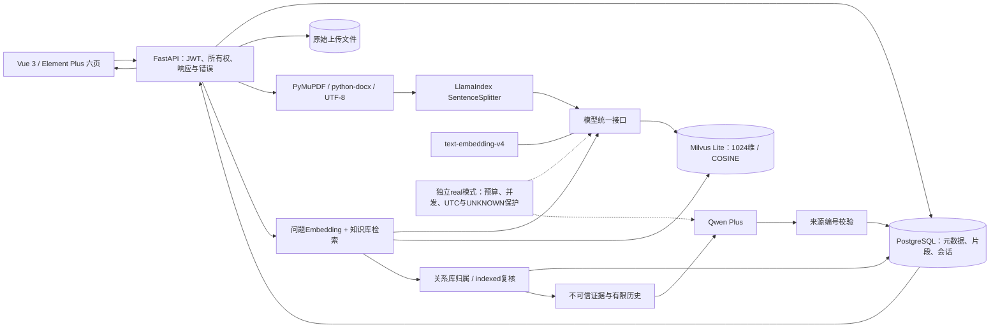

# 系统架构

Vue / Element Plus → FastAPI（JWT、Pydantic、统一错误）→ SQLAlchemy / PostgreSQL。
上传 → PyMuPDF/python-docx/UTF-8 → LlamaIndex SentenceSplitter → 模型适配 → Milvus Lite。
问题 → Embedding → 知识库限定检索 → indexed 元数据校验 → 不可信上下文 → Qwen/Mock → 历史事务。

## 模块

- api：路由、请求响应模型、所有权校验。
- core：配置、引擎、安全异常与日志。
- models：User、KnowledgeBase、Document、DocumentChunk、ChatSession、ChatMessage。
- services：状态机、索引、删除一致性、问答事务。
- rag：LlamaIndex 分块、解析、模型与向量适配。

LlamaIndex 实际使用 SentenceSplitter，不加载默认 OpenAI 模型或进行隐式下载。
Mock 使用确定的 SHA-256 特征哈希，1024 维，属于流程替身，不代表语义检索质量。

## 数据与约束

主键为 UUID 字符串。User.username 唯一；KnowledgeBase 的 owner_id/name 联合唯一；
DocumentChunk 的 document_id/chunk_index 联合唯一。
关联字段使用外键及 ON DELETE CASCADE，所有权、知识库、状态、会话有索引。
chunks 有 knowledge_base_id/document_id 联合索引，来源和历史引用用 JSON 保存。
SQLite 与 PostgreSQL 使用同一 ORM；Alembic 初始迁移独立冻结表结构。
create_all 仅便利初次本地启动，不替代后续迁移。

## 状态与事务

uploaded → processing（10% 解析、40% 向量）→ indexed（100%）；失败为 failed。
启动将中断的 uploaded/processing 标记 failed / PROCESS_INTERRUPTED。
进度表示处理阶段，不是字节比例。

文件显示名与磁盘路径分开；磁盘文件名为服务端 UUID。
上传按段读取，校验扩展名、大小、空文件；解析校验格式、DOCX 解压总量、文本总量。
PDF 每页分别分块，保存真实页码；Word/TXT/Markdown 没有伪造页码。

索引先写 Milvus，再在关系库一个事务里写 chunks 和 indexed 状态。
失败尝试幂等清向量；未 indexed 的记录不会被检索使用。
删除先提交 deleting 墓碑，再清向量、文件，最后事务删除 chunks/document。
失败保留可重试状态。知识库删除逐文档清理后级联会话。
全局进程锁使索引、查询、生成和删除串行；明确限制单 worker，适合演示规模。
模型成功后一次事务存 user/assistant 消息，失败不存半条对话。

## 检索与引用

Milvus 先限定知识库，关系库再验证 chunk/文档归属及 indexed。
Top-K 限 1–10，阈值默认 0.2；无证据不生成，直接明确说明。
历史最多十条，每条最多 4000 字符。
系统 Prompt 把历史与证据标为不可信数据；没有工具或代码执行路径。
模型只返回 JSON 和 source_ids，拒绝非法/越界引用及未声明的编号。
引用 ID、名称、片段和页码全部来自服务器检索结果。
source_id 保留原编号；只选第 2 条时仍显示 [2]。
文档删除不删除已存历史快照；会话或知识库删除会清快照。

Qwen 使用 OpenAI 兼容 HTTP，Embedding 每批最多 10 条，检查 1024 维与有限数值。
模型失败不会静默退回 Mock。两个模式分 collection，切换后应重新上传。

## 错误与日志

分类区分参数、格式、解析、数据库、Embedding、向量、模型、授权和内部异常。
不返回文件路径、密码 hash、授权头、供应商异常正文。
HTTP 中间件防止 ASGI 默认回溯泄露未知异常，后台任务也有安全边界。
日志只记录事件码与 request_id；不记录请求、正文、SQL参数或原始异常。
供应商详细诊断不传播，SQLAlchemy 使用 hide_parameters=True。
.env 和运行数据均被 .gitignore 排除。

## 兼容性与参考

Windows 本机 Python 3.12.16，Milvus Lite 3.2.2 / PyMilvus 3.0.2 已真实验证。
应用使用 VECTOR_URI 避免 SDK 的 MILVUS_URI dotenv 冲突。
实际版本在依赖锁文件中。

- [Milvus Lite](https://milvus.io/docs/milvus_lite.md)
- [LlamaIndex 按需安装](https://developers.llamaindex.ai/python/framework/getting_started/installation/)
- [阿里云兼容接口](https://help.aliyun.com/zh/model-studio/compatibility-of-openai-with-dashscope)
- [Embedding API](https://help.aliyun.com/en/model-studio/text-embedding-synchronous-api)

持久化集合在打开时显式 load_collection；关闭时释放本适配器的本地服务，避免只关闭客户端后文件锁仍占用。该生命周期有独立解释器回归。

## G6：分阶段文档与真实运行扩展

本文件继续作为总体架构入口；Windows下architecture.md与ARCHITECTURE.md属于同一路径，沿用既有名称，不新增仅大小写不同的文件。原六表业务结构仍有效，独立真实运行额外使用三张保护表，不把它们误写成用户业务实体。

这张图表示组件调用与数据依赖，不是额外的服务部署：Milvus Lite在后端进程环境内使用本地持久化，不是独立集群；Qwen与Embedding是外部付费服务。普通演示可替换为Mock；独立infrastructure模式使用DisabledModels，不能把拒绝模型调用写成真实成功。

[UsageGuard](../backend/app/real_usage/guard.py)的GuardState、ModelCall、Operation分别保存暂停/时间纪元、模型请求/费用和业务操作指纹；PostgreSQL行锁约束预留事务，锁外执行HTTP后再核验usage。六张业务表见[业务模型](../backend/app/models/__init__.py)，三个保护模型定义在guard.py，独立迁移位于[real_usage_migrations](../backend/real_usage_migrations/)。

[GuardedModels](../backend/app/real_usage/models.py)只在独立真实入口启用，限制输入估算与输出、超时及无重试；不能把这些保护泛化为普通Mock应用的全站限流。真实预算是可记录请求的应用上限，不是云账单保证。

8080是原Mock演示布局，8081使用独立前后端、关系卷、向量/上传卷和审计卷；本次不验证现场状态、不操作容器。后台任务、Milvus文件锁和启动恢复均要求单worker。

阅读[开发计划](development-plan.md)、[实际历程](development-history.md)，或从[Stage 3解析](stage3.md)、[Stage 5问答](stage5.md)、[Stage 7安全](stage7.md)按主题进入。图和描述均对应当前源码，不引入其他项目组件；历史阶段名称不代表Git版本。
