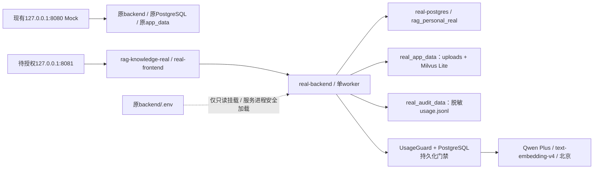

> 当前修订（2026-11-18）：R2已增加显式infrastructure模式，不读取/挂载/注入模型Key，模型操作统一拒绝。
> 最新入口与待审批材料见无密钥R2部署方案（本地专用材料，不随发布源码分发）及新审批（本地专用材料，不随发布源码分发）。
> 旧R1正文保留作历史说明，其旧摘要不能用于当前修改后制品；不要直接执行下方旧真实模式命令。
> real实现与费用保护保留，但需匹配当前代码的新real审批；本轮没有部署、数据库或付费操作。

> GitHub副本说明：标为“本地专用”的原始证据未纳入Git，不是可下载附件。分类及存在性见[本地材料索引](LOCAL_EVIDENCE_INDEX.md)；不复制原始审计或用户数据来补齐链接。

# R1 真实长期使用环境架构（离线准备）

状态：OFFLINE PASS / DEPLOYMENT NOT_RUN / REAL RAG NOT_VERIFIED。
本轮没有Docker操作、真实数据库连接、密钥内容读取或付费请求；历史真实请求仍6。
R1是独立候选环境，不将新保护能力描述为已经在8080启用。

## 1. 双环境分离

现有根docker-compose.yml、原Dockerfile、原数据卷和现有镜像均未改动。
真实配置是[deploy/real-usage/compose.yml](../deploy/real-usage/compose.yml)，项目名rag-knowledge-real，
所有服务均在real-usage profile内，默认不启动。
前端新镜像和后端新镜像使用rag-knowledge-real-*名称，不覆盖演示镜像标签。

| 资源 | 真实候选 | 与演示关系 |
|---|---|---|
| 入口 | 127.0.0.1:8081→80 | 不占8080；端口可用性尚未现场验证 |
| 后端 | real-backend:8000；仅内部 | 不重启原backend |
| PostgreSQL | real-postgres，独立实例/DB rag_personal_real，用户rag_real | 独立real_pg_data，不连接原库 |
| 向量及上传 | real_app_data:/data，/data/milvus.db和/data/uploads | 不挂原app_data |
| 审计 | real_audit_data:/audit；usage.jsonl | 不混入M5或演示账本 |
| 运行日志 | 新容器自己的stdout/stderr；后端关闭访问日志/不记请求正文；前端沿用Nginx默认访问日志 | 非原容器日志；生命周期错误只给安全码 |
| 网络 | Compose按项目生成rag-knowledge-real_default | 不使用external或固定共享网络；恢复副本也必须新项目 |
| 凭据 | PG/JWT专用文件，模型仍复用backend/.env | API Key不另存，不进入前端/镜像 |

Milvus Lite仍嵌在真实后端环境内，固定3.2.2目录式持久化；
没有新增Redis、Celery、独立Milvus集群或消息中间件。

## 2. 真实配置与兼容性

MODEL_BACKEND=qwen、ALLOW_PAID_MODELS=true、QWEN_MODEL=qwen-plus、
EMBEDDING_MODEL=text-embedding-v4、EMBEDDING_DIMENSION=1024。
QWEN_BASE_URL固定https://dashscope.aliyuncs.com/compatible-mode/v1，
模型、地域和定价不匹配即拒绝，而非偷偷改模型或回退Mock。

Qwen和Embedding通过同一安全加载的服务端Key；目前仅确认backend/.env文件存在，
未读取其值，也未验证当前账号/地域/额度/容器UID可读性。
Settings使用env_file=None；PG连接与JWT由运行入口读取专用secret文件后直接传对象，
不写全局环境。原dotenv加载器的优先级保持：
非空进程变量→显式dotenv文件→旧raw文件；dotenv禁用插值。

当前官方资料支持本方案的qwen-plus北京非思考及text-embedding-v4的1024维/每批10条：
[Qwen](https://help.aliyun.com/zh/model-studio/qwen-plus)、
[Embedding](https://help.aliyun.com/zh/model-studio/text-embedding-synchronous-api)。
仅模型规格/价格资料核对，不是调用接口或账号可用性验证。

## 3. 对既有代码的必要接点

- app.factory从原main提取创建逻辑，库导入不实例化Settings；
  main仍暴露原create_app和ASGI app，原Mock默认不启用R1保护。
- 工厂允许setup及独立api_routers；真实应用先组合路由再注册，
  规避当前FastAPI0.163的IncludedRouter封装，不修改全局Mock路由。
- 文档/问答服务通过get_models(state)取可选注入模型；缺省仍为原make_models。
- 文档服务只在真实配置存在max_document_chunks时检查片段上限。
- Alembic仅在R1入口额外扫描real_usage_migrations，执行001→r1_001；
  原Mock迁移路径仍只有001，原六业务模型及冻结迁移未改。
- 前端只增加保护错误码的中文映射；当前8080镜像没有重建，新增文案未在演示服务热更新。

R1独立库包含原六张业务表和三张门禁表：
real_usage_guard（暂停与历史基线）、real_usage_calls（计数/预留/usage）、
real_usage_operations（HMAC指纹/状态）。三表有独立冻结迁移，不加进原业务Base。

## 4. 长期持久化与一致性

用户、KB、文档、片段、会话与引用沿用PostgreSQL事务；
原文件和Milvus同在真实app卷，处理/检索/删除共用进程锁。
不会因为重启自动重建向量或重发模型请求；uploaded/processing中断会failed，
门禁中的RUNNING/SENT_UNCERTAIN在启动恢复时失败/UNKNOWN并保持暂停。

门禁计数与估算预留存PostgreSQL，不因重启或更换审批ID清零。
历史基线固定6；R1尝试、已验证请求与累计尝试上界分开，未知请求不冒充“确定未计费”。

原跨存储补偿、deleting墓碑、indexed复核及引用快照仍沿用。
它们不是分布式事务；R1仍单实例、单worker、BackgroundTasks，
没有持久化任务队列或自动索引重试。大文档可能在中途遇到限频/额度而failed，
已发出的批次仍计费，必须先核对，不可盲目重新上传。

## 5. 费用和请求保护

| 保护 | 首次验证待审值 | 长期提案（未启用） |
|---|---:|---:|
| 全历史R1模型请求上限 | 3 | 0表示取消总上限，仍有日限额；须新审批 |
| 每日请求 | 60，UTC日 | 60 |
| 估算日预算 | ¥0.01 | ¥1 |
| 输入Token估算门禁 | 4096 | 8192 |
| 输出max_tokens | 256 | 512 |
| 模型请求频率 | 6/滚动60秒 | 同左 |
| 模型/写入流程并发 | 各1，拒绝排队 | 同左 |
| HTTP超时/重试 | 30秒/0，关闭重定向及环境代理 | 同左 |
| 重复内容窗口 | 300秒 | 同左 |
| 上传/片段 | 20MiB/32片段 | 同左，可另审 |

实际默认是首次验证档，personal.env.example只是未激活提案。
启动时配置必须逐项等于审批清单limits，不能靠环境变量暗中扩大额度。
输入门禁使用UTF-8字节及聊天封装余量作为保守估算，不是官方Qwen tokenizer；
响应usage也会核对，超限/缺失/不完整输出立即暂停。
应用只控制自身可知请求及估算，不保证云账单绝不超限。

## 6. 离线证据及下一步

30个不同R1离线案例最终PASS；前端类型检查PASS。
覆盖配置/Key缺失、计数持久化、Token/预算/限频/并发、超时、
入口防重/所有权、后台failed、Mock默认、迁移DDL及备份安全。
实际PostgreSQL迁移、Milvus目录持久化、镜像构建/启动、只读Key挂载及真实RAG均NOT_RUN。
旧M1–M6.6证据保留，不把它们写成R1新增真实PASS。
详情见部署方案（本地专用材料，不随发布源码分发）、[安全说明](REAL_USAGE_SECURITY.md)、
待审批材料（本地专用材料，不随发布源码分发）。