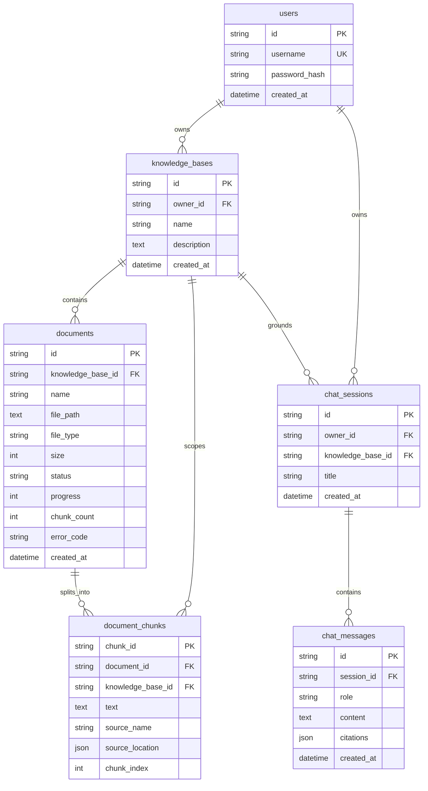

# 数据库设计与ER图

依据：[SQLAlchemy模型](../../backend/app/models/__init__.py)、
[冻结初始迁移001](../../backend/migrations/versions/001_initial.py)。
本轮未连接PostgreSQL或SQLite，结构由源码静态核对；历史迁移一致性证据见测试报告。

## 1. 存储分工

六张业务表共38个字段、7个外键。关系库使用SQLAlchemy通用类型；
Compose采用PostgreSQL16，本地开发允许SQLite。SQLite通过测试不等同于PostgreSQL验收。
Alembic工具可维护alembic_version版本记录，它不是第七个业务ORM模型，不画成业务实体。

正文片段与历史存关系库；向量存Milvus Lite；原始文件在文件系统。
没有pgvector、用户角色表、独立embedding关系表或数据库内API Key表。

## 2. ER图

[独立图源](diagrams/02-database-er.mmd)。
连线表示真实外键，不表示代码声明了ORM relationship；当前模型没有relationship()属性。
一个父记录可没有子记录，每个子记录的外键非空。
citations中的文档ID是JSON快照字段，不是chat_messages指向documents的数据库外键。

## 3. 字段字典

下面“默认”均指ORM/Python端插入默认值。迁移未声明这些server_default，
直接SQL插入时不能依赖数据库自动补齐。
除documents.error_code允许NULL外，其余业务字段按Mapped非可选注解或显式约束为NOT NULL。
所有id/chunk_id为VARCHAR(36)的UUID字符串，不是PostgreSQL原生UUID类型。

### 3.1 users：用户

| 字段 | SQLAlchemy类型 | 键/约束 | 默认与说明 |
|---|---|---|---|
| id | String(36) | PK | uid()生成UUID字符串 |
| username | String(64) | UNIQUE | 用户登录名 |
| password_hash | String(256) | 非空 | 随机盐与scrypt散列的组合；不返回客户端 |
| created_at | DateTime(timezone=True) | 非空 | now()，UTC时间 |

没有明文password、email、phone、role或updated_at字段。

### 3.2 knowledge_bases：知识库

| 字段 | 类型 | 键/约束 | 默认与说明 |
|---|---|---|---|
| id | String(36) | PK | uid() |
| owner_id | String(36) | FK→users.id；索引 | 所有者 |
| name | String(120) | 与owner_id联合唯一 | 同用户下不重名 |
| description | Text | 非空 | 空字符串 |
| created_at | DateTime(timezone=True) | 非空 | now() |

### 3.3 documents：文档

| 字段 | 类型 | 键/约束 | 默认与说明 |
|---|---|---|---|
| id | String(36) | PK | uid()；上传流程显式生成UUID |
| knowledge_base_id | String(36) | FK→knowledge_bases.id；索引 | 文档所属知识库 |
| name | String(255) | 非空 | 清理后的显示文件名 |
| file_path | Text | 非空 | 服务端本地路径；不进入DocumentOut |
| file_type | String(12) | 非空 | pdf/docx/txt/md |
| size | Integer | 非空 | 上传字节数 |
| status | String(20) | 索引 | uploaded；不是数据库Enum |
| progress | Integer | 非空 | 0；阶段进度 |
| chunk_count | Integer | 非空 | 0；已提交片段数量 |
| error_code | String(64) | 可NULL | 失败分类码；不是原始异常文本 |
| created_at | DateTime(timezone=True) | 非空 | now() |

状态与进度没有数据库CHECK约束，合法转换由业务服务控制。

### 3.4 document_chunks：文档片段

| 字段 | 类型 | 键/约束 | 默认与说明 |
|---|---|---|---|
| chunk_id | String(36) | PK | uid()；索引流程显式生成UUID |
| document_id | String(36) | FK→documents.id | 原始文档 |
| knowledge_base_id | String(36) | FK→knowledge_bases.id | 检索隔离所需冗余归属 |
| text | Text | 非空 | 清洗分块后的文本 |
| source_name | String(255) | 非空 | 文档显示名称快照 |
| source_location | JSON | 非空 | PDF的format/page或DOCX的format/section等 |
| chunk_index | Integer | 与document_id联合唯一 | 从0开始的全局片段序号 |

两个外键分别有效并不保证document_id对应的文档必属于相同knowledge_base_id；
写入时从Document统一赋值，检索时再次JOIN并校验两者。没有虚构复合外键。

### 3.5 chat_sessions：会话

| 字段 | 类型 | 键/约束 | 默认与说明 |
|---|---|---|---|
| id | String(36) | PK | uid() |
| owner_id | String(36) | FK→users.id；索引 | 当前用户 |
| knowledge_base_id | String(36) | FK→knowledge_bases.id；索引 | 会话固定关联一个知识库 |
| title | String(120) | 非空 | 新会话；首次成功问答时可改为问题前120字符 |
| created_at | DateTime(timezone=True) | 非空 | now() |

owner与知识库owner一致性由owned_kb/owned_session控制，非数据库复合约束。

### 3.6 chat_messages：消息

| 字段 | 类型 | 键/约束 | 默认与说明 |
|---|---|---|---|
| id | String(36) | PK | uid() |
| session_id | String(36) | FK→chat_sessions.id；索引 | 所属会话 |
| role | String(16) | 非空 | user或assistant；响应模型用Literal约束 |
| content | Text | 非空 | 问题或回答 |
| citations | JSON | 非空 | list工厂；检索来源完整快照 |
| created_at | DateTime(timezone=True) | 非空 | now() |

JSON实际类型为SQLAlchemy JSON，不是源码中不存在的JSONB字段。
引用快照包括来源正文，真实部署应按业务的数据保留要求管理，不能假定删文档等于抹除历史。

## 4. 外键、唯一约束与索引

7个外键全部ON DELETE CASCADE：KB→User、Document→KB、Chunk→Document、Chunk→KB、
Session→User、Session→KB、Message→Session。

| 类别 | 已声明内容 |
|---|---|
| 主键 | 六张表各一个；DocumentChunk使用chunk_id |
| 唯一 | users.username；knowledge_bases(owner_id,name)；document_chunks(document_id,chunk_index) |
| 显式普通索引 | ix_knowledge_bases_owner_id |
| 文档索引 | ix_documents_knowledge_base_id；ix_documents_status |
| 片段索引 | ix_chunks_kb_doc(knowledge_base_id,document_id) |
| 会话索引 | ix_chat_sessions_owner_id；ix_chat_sessions_knowledge_base_id |
| 消息索引 | ix_chat_messages_session_id |

共7个显式普通索引；主键/唯一约束的数据库实现索引另计，不混算。
未给所有外键虚构独立单列索引，也未给未命名唯一约束编造数据库名称。

数据库级CASCADE只处理关系数据，不会清理Milvus或磁盘文件。
应用删除知识库必须走业务服务，不能绕过服务直接删父行并声称外部索引也已清除。

## 5. Milvus集合设计

MilvusVectors使用collection名rag_mock_1024_v1或rag_qwen_1024_v1。
create_collection固定dimension=1024、primary_field_name=chunk_id、字符串主键最大36、
auto_id=False、metric_type=COSINE、enable_dynamic_field=True。

插入行包含chunk_id、document_id、knowledge_base_id、vector。
正文、名称和source_location从关系库读取，不在Milvus行中重复写入。
检索输出chunk_id，按knowledge_base_id过滤，返回distance作为相似度分数。

当前固定milvus-lite3.2.2的受控验收为目录式存储；
路径虽名为vectors.db或milvus.db，不能据后缀认定它是普通单文件。
collection自动生成的其他系统字段未在本轮连接描述，标记NOT_VERIFIED，不虚构其结构。

## 6. 事务与迁移说明

上传文件写入成功后commit Document；后台先提交processing=10，再提交progress=40，
写向量后同次提交chunks和indexed=100。异常rollback并尝试清向量，再记录failed。
这不是跨存储原子事务，补偿清理失败可能残留不可检索向量。

删除先提交deleting，再清向量、删片段与文件、删文档并commit。
若删除向量失败，元数据保留deleting，可通过原DELETE重试；
知识库逐文档删除可能部分完成，不承诺整体回滚。
成功问答在一个关系事务中添加两条消息和标题更新。

Alembic001独立冻结六表结构，env.py使用Base.metadata做迁移比较；
服务启动有create_all便利逻辑，但不能替代将来的结构迁移。
历史PostgreSQL验收包含迁移无漂移检查，本轮不重跑或实时比较生产数据库。