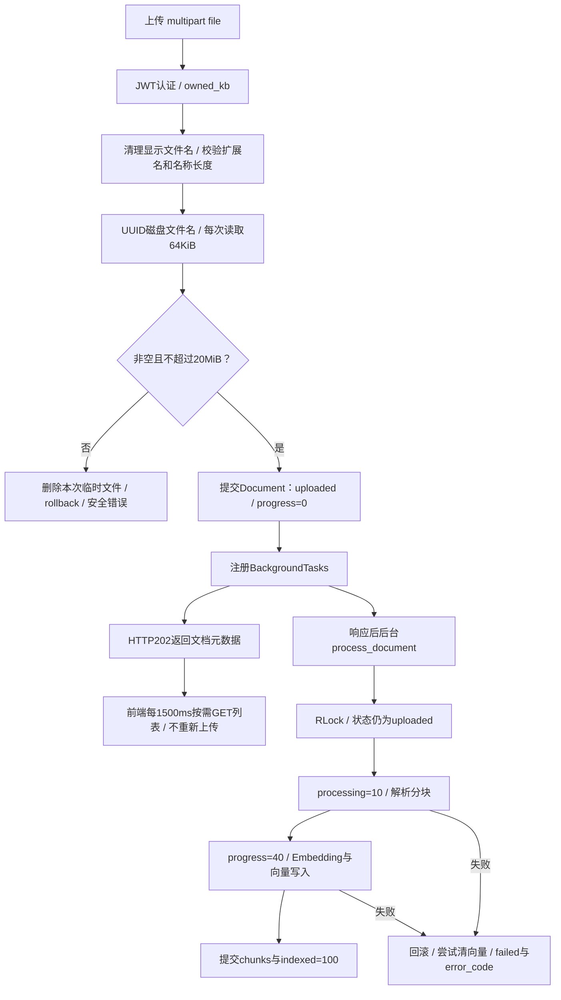
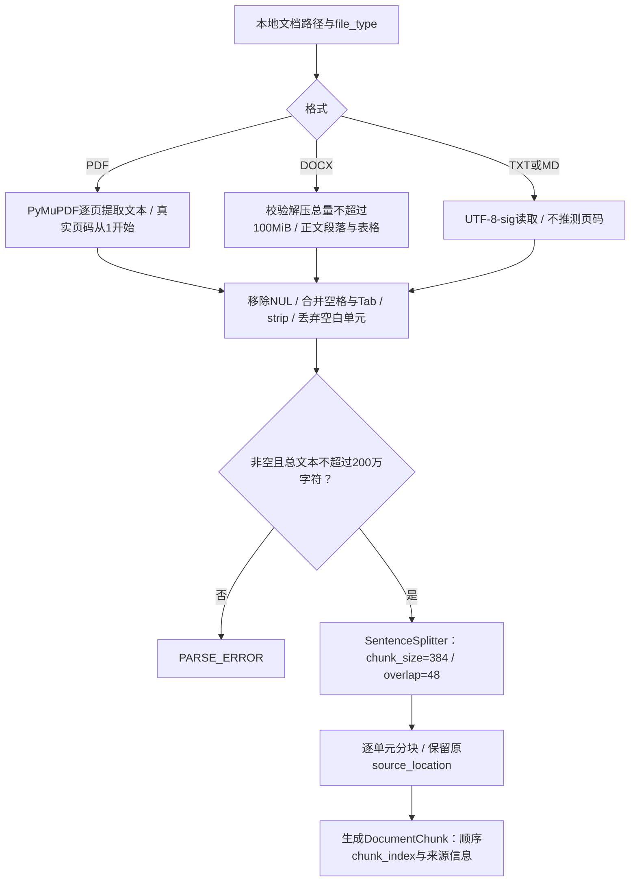
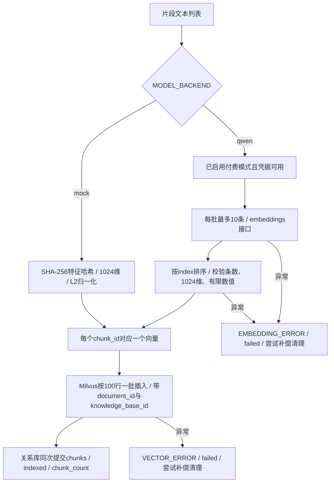
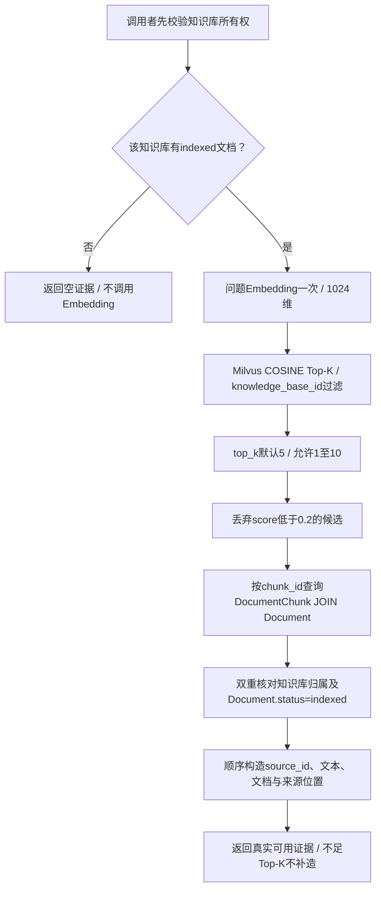
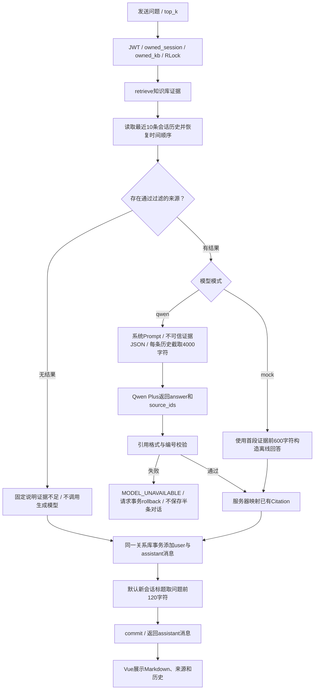
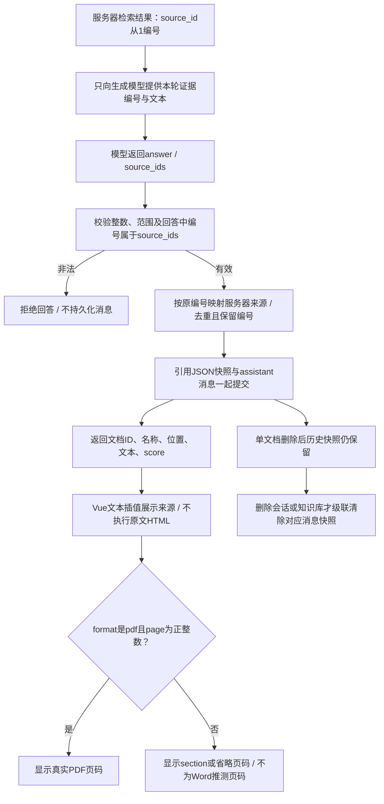

# RAG核心实现与流程设计

依据：[解析](../../backend/app/rag/parsing.py)、[模型](../../backend/app/rag/providers.py)、
[向量](../../backend/app/rag/vectors.py)、[文档服务](../../backend/app/services/documents.py)、
[问答服务](../../backend/app/services/chat.py)。下述为实际V1流程，不含规划功能。

## 1. 实现分工

RAG将本轮检索片段提供给回答生成器。项目没有训练/微调模型；
SentenceSplitter负责分块，自有retrieve/send_message负责检索与组装，
QwenModels直接通过httpx调用兼容HTTP接口。
MockModels与MemoryVectors是离线替身；当前演示是MockModels+真实Milvus Lite，
不能把“Mock模式”理解成所有数据库也被替换成内存。

## 2. 文档上传

[图源](diagrams/03-document-upload.mmd)。
文件先在认证的知识库范围内保存，名称和磁盘路径分离；返回202不意味着已经索引成功。
文档状态查询与列表均为GET，不会重新解析或调用模型。
后台异常发生于202之后，只能通过status/error_code得知，不改写先前HTTP响应。
前端1500ms轮询仅在uploaded/processing存在且上次请求已完成、无加载错误时进行。

## 3. 解析、清洗与文本分块

[图源](diagrams/04-parse-and-chunk.mmd)。
PDF每页独立分块，page为实际提取页序号+1；不会把相邻页的块合并后推测页码。
DOCX读取段落及表格行，标识正文section；不能提供稳定打印页码。
TXT/MD读取UTF-8-sig。清洗去NUL、合并空格/Tab并strip，不承诺保留原始字符偏移。
size=384/overlap=48是SentenceSplitter的分块参数，遵循其token规则。
没有OCR、图片理解、版式识别或面向表格的专用检索模型。

## 4. Embedding与索引

[图源](diagrams/05-embedding.mmd)。
Mock按英文词、中文字符及双字特征做SHA-256散列并归一化成1024维，
只提供可重复的流程验证，不代表语义模型质量。
Qwen模式的Embedding为text-embedding-v4；每批最多10条，按服务返回index排序，
核对条数、维度及有限数值，不接受无效向量。

doc.progress=40后调用Embedding，再建立带UUID的DocumentChunk及向量行。
Milvus写入每批100行，随后关系库提交片段与indexed状态。
若任何步骤失败，rollback关系事务、尝试删除已写向量并记录failed；
补偿失败不对用户暴露原始异常，检索只使用indexed元数据。
没有向量/关系库两阶段提交、自动重建全库索引或后台自动重试队列。

## 5. 知识库检索

[图源](diagrams/06-vector-retrieval.mmd)。
若无indexed文档，直接返回[]，连问题Embedding也不调用。
否则问题Embedding一次，Milvus按知识库过滤后取Top-K，score默认至少0.2；
再以DocumentChunk JOIN Document检查同KB及indexed状态，避免删除中或索引失败的来源进入回答。
Top-K为候选数上限，过滤后可能不足K；没有补召回、BM25混合检索或重排。

阈值是当前实现的启发式规则，不是经过大样本调优的置信度概率。
检索后的“有证据”指至少一条通过过滤的来源，不是实现了语义充分性判定器。

## 6. 问答、上下文和持久化

[图源](diagrams/07-rag-question-answer.mmd)。
当前问题绑定会话所属知识库，不允许客户端借session_id跨用户访问。
历史查询最多10条，并恢复时间顺序；发给真实模型时每条只取前4000字符。
当前问题上限4000字符；证据来自本次Top-K片段，不是整份文档。

系统Prompt要求仅根据证据回答，把证据和历史视为不可信数据，
忽略改变规则、泄露信息或执行操作的指令，要求返回answer/source_ids JSON。
没有工具执行或Agent链路。Prompt并不能证明对所有注入攻击免疫。

Mock回答为首段前600字符加[1]；没有来源则两模式都返回固定“证据不足”说明。
Qwen参数为temperature=0.1、response_format=json_object。
普通QwenModels适配器未设置统一max_tokens或用户预算；
历史真实验收的max_tokens=256、非思考及2+1请求硬限由专用受控执行器追加，
不能写成所有生产问答都自动受同样预算保护。

生成成功且引用合法后才添加user/assistant消息并commit，
默认新会话标题更新为问题前120字符。模型异常时不保存半条对话。
无证据的固定答复仍保存这次问答，两条消息且citations为空。
返回完整回答而非流式输出；前端busy/uncertain保护避免在结果不确定时自动重发。

## 7. 来源引用处理

[图源](diagrams/08-citation-processing.mmd)。
来源source_id按照检索结果从1编号，模型只能选择该集合中的编号。
校验source_ids是列表、每项为整数且范围合法；回答中的[n]必须属于所声明编号集合。
无有效source_ids时回退为证据不足说明；异常JSON或非法编号安全拒绝。
去重保留顺序；仅选第2条时仍为[2]，不重编号为[1]。

文档ID、名称、文本、位置均由服务端映射，不采纳模型自造的文档信息。
这能阻止越界编号，不能保证回答每一句事实都正确，仍应核对原文。
citations作为JSON快照保存，单文档删除后仍可在历史查看；
会话/知识库删除会级联清除对应消息。

前端MessageItem按PDF格式及正整数page显示页码；其他格式显示section或无页码。
来源文本使用普通插值，回答Markdown则禁用原HTML后再净化，二者机制不同。
不自动打开原始文件，也不对引用原文再次请求模型。

## 8. 错误、模式和真实证据边界

httpx.Client超时60秒、trust_env=False，业务适配器无自动重试循环；
外部失败归类EMBEDDING_ERROR或MODEL_UNAVAILABLE，不把真实失败静默切回Mock。
模型模式变化会选择不同collection；旧关系元数据不会自动重新索引，
需要在另外授权的迁移/测试范围内准备新知识库与索引。

M5真实验收为179字节合成TXT、1片段、1问题：
两次Embedding、一次Qwen，回答17天[1]，COSINE约0.728、来源与历史一致。
两次真实验收合计6次请求；当前Mock演示不消耗付费请求。
未验证大样本召回率、复杂PDF语义效果、真实模型对抗行为和并发性能。
详见 [测试报告](SYSTEM_TEST_REPORT.md)。