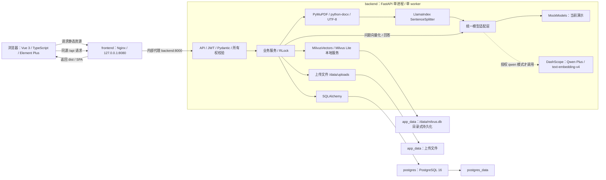

# 总体系统架构与模块设计

版本V1.0；依据当前源码和M6.6保存的部署证据。M7不操作Docker或数据库，不现场复查服务存活。

## 1. 总体架构



[独立图源](diagrams/01-system-architecture.mmd)。
实线表示应用内/本地调用；Qwen虚线为受授权真实模式分支，当前Mock演示不调用该外部服务。
Milvus Lite运行在后端环境并由适配器管理本地服务；Compose没有单独的Milvus容器。
LlamaIndex只承担SentenceSplitter分块，并未用其QueryEngine或默认OpenAI模型。

## 2. 技术栈与固定版本

以下版本来自依赖锁文件或Dockerfile标签，不是M7执行安装或运行时探针所得。

| 层 | 实际组件 | 锁定版本/配置 |
|---|---|---|
| 前端 | Vue / TypeScript / Vite / Element Plus | 3.5.45 / 5.9.3 / 7.3.8 / 2.14.8 |
| 前端状态与通信 | Pinia / Vue Router / axios | Pinia3.0.4、axios1.21.1；Router使用现有锁文件 |
| 回答展示 | markdown-it / DOMPurify / highlight.js | 14.3.3 / 3.4.18 / 11.12.0 |
| Web后端 | Python / FastAPI / Pydantic | Python3.12镜像；FastAPI0.163.1、Pydantic2.14.3 |
| 配置及ORM | pydantic-settings / SQLAlchemy / Alembic | 2.16.3 / 2.0.58 / 1.20.1 |
| 关系库及驱动 | PostgreSQL / psycopg | postgres:16-alpine / 3.3.9 |
| 文档处理 | PyMuPDF / python-docx | 1.28.2 / 1.2.0 |
| RAG分块 | llama-index-core | 0.14.26 |
| 向量存储 | pymilvus / milvus-lite | 3.0.2 / 3.2.2 |
| 模型协议 | httpx，OpenAI兼容HTTP | 0.28.1；不使用OpenAI SDK |
| 模型 | qwen-plus / text-embedding-v4 | 通过配置选择；Embedding固定1024维 |
| 测试 | pytest / Playwright | 9.2.0 / 1.65.1 |
| 静态服务 | Nginx | Dockerfile为nginx:1.28-alpine |

项目锁文件：[Python](../../backend/requirements.lock.txt)、[Node](../../frontend/package-lock.json)。
requirements.txt为兼容范围，实际复现优先使用锁文件；不能把“>=某版本”当安装结果。

## 3. 实际目录与职责

```text
RAG-Knowledge/
  backend/
    app/api/          base.py / documents.py / chat.py / deps.py
    app/core/         config.py / db.py / errors.py
    app/models/       六个SQLAlchemy模型
    app/schemas/      Pydantic请求、响应、引用与统一包络
    app/services/     documents.py / chat.py
    app/rag/          parsing.py / providers.py / vectors.py
    app/main.py
    migrations/       env.py / versions/001_initial.py
    tests/            API、业务、安全、PG及Milvus测试
    requirements.txt / requirements.lock.txt / Dockerfile
  frontend/
    src/api/ components/ views/ router/ stores/ styles/
    tests/ scripts/   Playwright与隔离Mock运行器
    Dockerfile / nginx.conf / package-lock.json
  scripts/            本地启动、设施检查及受控真实验收
  samples/            合成PDF、DOCX、TXT
  data/               本地运行/历史审计；不纳入公开毕业材料原始数据
  docs/               阶段材料、截图、本交付目录
  docker-compose.yml / README.md / AGENTS.md
```

迁移实际在backend/migrations，不是backend/alembic目录。
data仅描述用途，不公开认证材料或原始敏感日志；本包只引用经过筛选的证据摘要。

## 4. 六个功能模块

| 模块/目标 | 核心业务流程 | 主要接口 | 关键实现 |
|---|---|---|---|
| 用户管理：建立用户身份 | 注册散列保存；登录比较散列；校验JWT sub/exp；前端退出清理sessionStorage | auth/register、auth/login、auth/me | scrypt、PyJWT、HTTPBearer、Pinia；无角色表 |
| 首页：概览当前用户资源 | GET知识库与会话；按每个知识库GET文档并计数；失败显示未知值 | knowledge-bases、sessions、各KB documents | Promise.allSettled；无独立统计API |
| 知识库：组织资料 | owned_kb；创建/更新并提交；删除逐文档清理后删知识库 | knowledge-bases及/{kb_id} | 联合唯一约束、所有权依赖、RLock |
| 文档：从上传到可检索 | 校验保存→202→BackgroundTasks→解析分块→向量→indexed；前端轮询 | documents上传/列表/状态/删除 | UUID文件名、PyMuPDF、python-docx、SentenceSplitter |
| AI问答：文档支撑的回答 | owned_session→retrieve→模型→校验引用→双消息提交→展示 | sessions/{session_id}/messages；KB search | 统一模型层、COSINE、阈值与元数据复核、净化Markdown |
| 会话历史：保存与恢复 | 当前用户会话列表→读取消息与来源快照→继续问答/删除 | sessions及messages GET | PostgreSQL JSON快照、时间排序、前端选中态及延迟响应序号 |

精确路径、请求模型和状态码见 [API参考](API_REFERENCE.md)。

## 5. 认证、隔离与安全边界

current_user解码HS256 JWT并按sub获取用户，默认有效期12小时。
owned_kb按id与owner_id查询；owned_document再限定knowledge_base_id；
owned_session同时校验会话owner及其知识库owner。不存在或未拥有返回404。

向量检索先过滤knowledge_base_id，关系库再次JOIN文档并验证状态indexed。
这是基础用户隔离，不是多组织权限体系。数据库两个独立外键并不自动保证会话owner与KB owner相等，
由业务校验承担，详见 [数据库设计](DATABASE_DESIGN.md)。

回答Markdown禁用原始HTML，随后DOMPurify净化；图片仅显示说明文本，避免远程图片请求。
来源原文使用Vue文本插值。认证信息留在sessionStorage，不进入截图、日志或毕业材料。
这些措施不构成全面XSS/提示注入安全认证；真实模型对抗行为尚未全面验证。

## 6. 状态、一致性和运行约束

后台处理、检索、问答、删除共用进程级RLock并串行执行。
uploaded/processing中断在启动时改为failed/PROCESS_INTERRUPTED，不自动恢复持久化任务。
索引先写Milvus，再提交关系库chunks及indexed；失败尽力清除向量。
删除先提交deleting，再删向量、片段、文件及文档元数据；失败留待重试。
知识库删除不是一个涵盖所有外部资源的原子事务。

生成和引用校验成功后，user/assistant消息同次提交；服务失败不保存半条消息。
删除单文档保留历史引用快照，删除会话或知识库清除对应历史。
这些取舍适合演示规模，不能扩展描述为分布式强一致或高并发架构。

## 7. 实际部署与证据时点

Compose三个服务：frontend、backend、postgres。
Nginx仅将127.0.0.1:8080映射到80；backend:8000和postgres:5432均为内部服务。
app_data保存上传与Milvus持久化，postgres_data保存关系数据。
后端非root用户启动，先Alembic迁移，再以单worker启动Uvicorn。

M6.6已部署镜像f2f098f59255；当前版本管理需使用保留的candidate.compose.yml，
不能误用指向旧前端的latest。详细版本和命令见 [部署指南](DEPLOYMENT_GUIDE.md)。
M7只依据该次快照说明状态，不新增“当前服务在线”的探测结论。